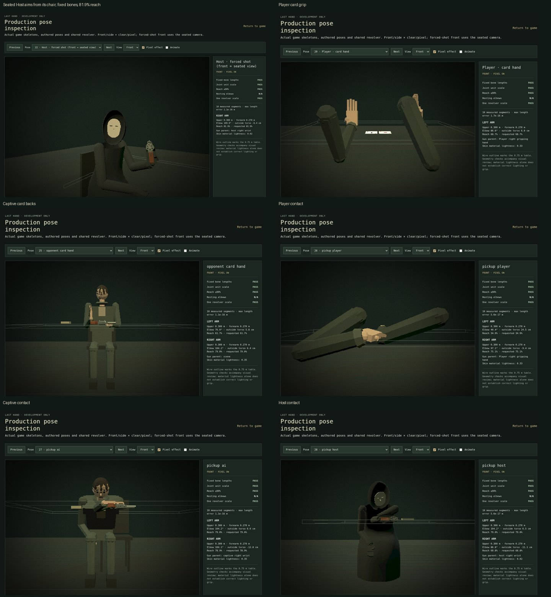

# Bug Update 1 verification

This update supersedes the older standing Host, side-delivery revolver, temple-contact enforcement, and random sideways gaze staging. The shared chamber rules, blackjack policies, campaign, captions, voices, room and pixel post-processing remain in place.

## Completed behavior

| Area | Result |
| --- | --- |
| Host | PASS — seated at the left for every phase; one smooth draped coat, recessed flat oval mask with eye slits, gloves and cold rim light. Guards handle the hood and restraint cuts. |
| Center pickup | PASS — shared 1.45–1.5 second look, lean, reach, grip, lift and torso-return phases. Fixed bones, unscaled gun, hand attachment from contact, controlled return to `[0, 0.780, 0]` after clicks and live shots, including deaths. |
| Timeout | PASS — an unfinished hold locks at the original deadline. The player returns the gun, the seated Host picks it up and aims at the player while the camera turns to it. One normal chamber pull follows the cocking pause. |
| Card grip | PASS — low player fan with palm toward the camera, thumb support and re-grip; captive backs face the player. Player cards turn down during shooting, including PEEK penalties without a showdown. Empty hand rests. |
| Context gaze | PASS — own cards / player / Host / gun targets; sound position has priority. PEEK distractions use card/deck glances and begin returning visibly before the window closes. No random sideways idle targets. |
| Sound gaze | PASS — left and right positioned sound buttons turn both characters toward that source, then restore context. Captive startles are faster and personality dependent; Host turns are slower. Head bounds remain 70° yaw / 30° pitch. |
| Regressions | PASS — PEEK corner visibility/reach, seated dealing, shuffle, camera look bounds, hidden card textures, shared revolver and campaign. |

## Why a single gunshot sounded like several

The old report graph sent the same sharp transient through separate **13, 26 and 39 ms delay taps**, and started a metallic layer **80 ms** later. Those separate attacks made the report sound repeated. Other-table deaths could also follow a local shot after only **2.4 seconds**, with only **3 seconds** between distant reports.

Inspection of the existing guarded shot transaction and identity tests did not find a second accepted local shot caused by React StrictMode. A Chromium run of the actual development App (which mounts under StrictMode) recorded exactly one accepted local ID, one chamber advance and a final center return after a loaded timeout shot.

The sharp layers now begin within **2 ms** of each other; the room response is a continuous generated convolution tail with no discrete delay taps. Every play attempt is logged with ID, source, AudioContext time and accepted/rejected status. Repeat IDs are rejected. Use `http://localhost:5173/?shots` to print these logs to the development console. Distant reports remain tied to monitor deaths and have a **4 second** gap from local shots in both directions and from one another. Empty clicks use their own dry graph.

## Validation record

The full suite was run once: **391/392 passed across 28 files**. The sole failure asserted the superseded rule that the Host looks sideways even while speaking. That assertion was replaced with actual world-target, seated-position, head-direction and speaking-bob checks; the complete affected regression file then passed **3/3**. All 392 current cases are covered by that full run plus the focused correction. The production TypeScript/Vite build passed once afterward.

Related development runs additionally covered pickup contact for all three shooters, constant arm lengths and reach, world cue positions and cancellation, same-onset audio layers, deduplication, card fronts/backs, face-down penalty cards and guard cutting reach. No browser console errors were observed.

Chromium review covered the seated Host, dealing, guard, three pickups at contact and raised positions, player/captive card grips, forced shot and left/right gaze reactions. Numeric review of the final Host aim measured **0.300 m upper arm**, **0.270 m forearm**, **81.9% reach**, unit scales and a hand-parented revolver. Desktop gameplay captures covered **1280×720, 1440×900 and 1920×1080**; a native run also exercised WASD, interrupted hold enforcement and fatal center return. Selected captures are below.

Open `?debug=poses` for the actual production rigs. Added cases include `host-seated`, `pickup-player`, `pickup-ai`, `pickup-host`, `opponent-card-hand` and `gaze-test`; the existing guard, player hand, dealing and forced-shot cases remain available. The pose time slider samples the shared pickup timeline. The left/right sound buttons unlock Web Audio only on click.
