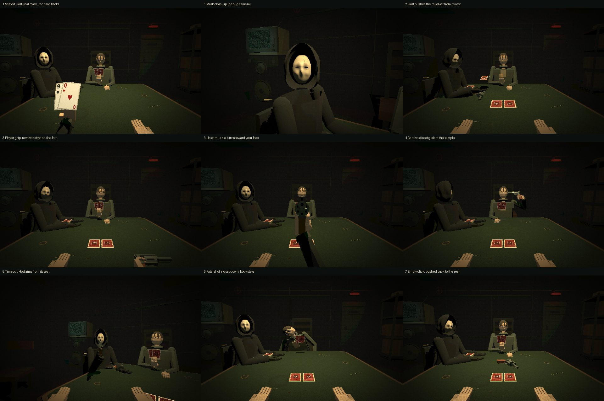

# Bug Update 2 verification

This update replaces the Bug Update 1 Host body, revolver choreography and death handling that looked wrong in play. Gameplay rules, chamber logic, dialogue, audio (including the single-gunshot fix), gaze priorities and the campaign are unchanged.

## What changed and why

| Reported problem | Cause | Fix |
| --- | --- | --- |
| Host looked about twice human size and covered the left of the screen | Its chair sat 0.93 m from the camera, closer than the captive | `HOST_SEAT` moves it back to the far-left side (1.55 m away; head about the captive's size). Deck moved within its right hand's reach |
| Flat disc mask with cartoon line eyes; perfect-circle hood; paddle gloves; mannequin sleeves | Flat extruded shape with 7 mm slit holes; sphere hood | Convex 3D mask shell (brow, nose, cheekbones, worn texture, hairline crack), pure-black almond eye holes, sculpted cloth hood with drooping peak and cowl, black interior; dark gloves and bell sleeves |
| Huge sideways revolver before the shot | Small Update 1 temple-contact aim pointed the barrel sideways | The pre-Small-Update-1 presentation is restored: the gripped revolver rests on the felt, then rises with the hold until the muzzle faces the player in the centre of view |
| Player's arm stretched across the table; camera lunged | The 1.3 m-deep table centre is out of a seated reach | The revolver rests in front of the Host. The Host pushes it to a spot inside the shooter's reach; the shooter takes it with a straight, direct grab. No camera lunge |
| Opponent dived head-first onto the table to pick it up | 0.9 rad spine lean | Same direct grab; lean stays under 0.25 rad and the head stays above the shoulders |
| Opponent's cards looked like a stick; right hand like a claw | The fan was parented to the wrist and turned edge-on; dark backs vanished against dark clothes | The fan is held in front of the chest with the backs facing the player, gripped from below. Relaxed resting hands |
| Face-down cards looked transparent | Dark green backs on green felt | Oxblood backs with a bone border |
| Player's idle left hand stood up like a wall | Palm rotated 180° upward | Empty hands rest on the felt edge, fingers relaxed |
| The captive set the revolver down neatly and then died; the body vanished | Bug Update 1 scheduled the controlled return after every shot, and the slump waited for it | A fatal shot never schedules a return. The head snaps, the body slumps sideways in the chair and stays; the revolver falls from the hand and stays where it lands |

## Choreography (presentation only, no chamber logic)

- Rest: `GUN_REST` in front of the Host, grip toward the Host, muzzle toward the player.
- `to-shooter` (1.5 s): the Host's left hand pushes the revolver (`PUSH` of the route), it glides along `gunSlidePoint` (a wide curve that never crosses 1–3 card hands), then the shooter grabs it. The captive lifts it to its temple; the player keeps it gripped on the felt until HOLD TO PULL raises it.
- `return` after an empty click: set down at the spot, push, glide back to the rest. After a forced shot the Host sets it down at the rest.
- Timeout (`HOST_FORCE_SHOT`): the player pushes the revolver back, the seated Host takes it with its left hand and aims from its seat along the line from its mask to the player's head. The camera turns to the Host after the push.

## Validation

Scene, layout and skeleton tests were updated to the new rules and extended with regression checks for each reported problem: Host distance and real 3D mask, push-and-grab without stretching for both shooters, the Host's left-hand pickup, the muzzle facing the player at full hold, captive card backs facing the player above the table, the captive staying upright while grabbing, no set-down after a fatal shot with the body still in its chair, the empty hand resting on the felt, and the slide route never crossing a 1–3 card hand.

