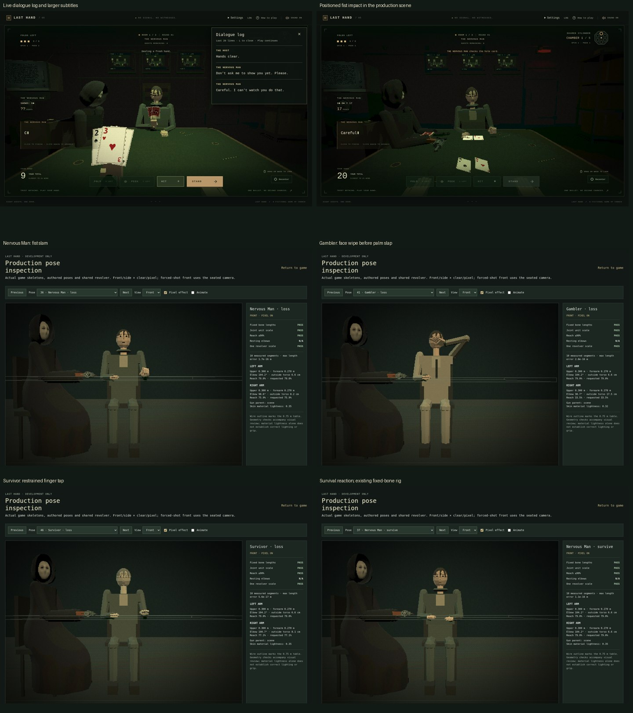

# Small Update 2: readability, dialogue and reactions

Built on Bug Update 2 (`6d81904`). The Host model and seat, mask, deck and revolver rest, push-and-grab paths, card grips, blackjack/chamber rules, campaign and death/slump implementation remain in place.

## Readability

- Normal text types at approximately 28–32 letters per second across the existing voice profiles. Settings offers Slow / Normal / Fast. A setting change applies when the next line starts, preserving the active text/voice clock.
- The existing seeded murmur and letters share a timeline. Syllables, formants, pitch, distortion, room mixing, mute and click-authorized audio stay on the existing system.
- After typing, automatic advancement waits at least `1500 + 60 × character count` milliseconds. The first click finishes unfinished text and fades its voice; the next click advances. A naturally finished line can be advanced with a click. Urgent procedural speech queues behind the current readable line; the actual trigger deadline keeps running.
- Status/result messages use a separate FIFO display queue, with at least 2.5 seconds per displayed message. This queue never delays inputs or chamber logic. The existing 1.5-second result pause retains both revealed totals before a shooting phase.
- Subtitles are 18 px on the 1440 px stage, with higher contrast and a comfortable line width; the existing stage scaling handles other desktop sizes.
- L or LOG opens a nonmodal, scrollable history of the last 20 shown lines with the correct Host/captive name. Keyboard look and game actions continue. L is ignored while editing a field; Escape closes the panel.

## Dialogue

All three captive banks, begging lines and exchanges were rewritten in their existing categories: fragmented fear for the Nervous Man, strained bravado for the Gambler, and restrained trauma for the Survivor. The Host pools are brief and procedural. The scripted campaign, rule information and final Host line are retained.

Context templates use only public information: spent chambers, remaining folds, the captive's visible upcard, and the player's total after reveal. A match-long memory reserves queued lines as well as spoken ones, prevents reuse, and avoids consecutive matching two-word openings. It also checks actual publication order, including prioritized Host announcements. Exhausted banks become quiet instead of recycling lines. A new run resets this memory; room transitions do not.

## Reactions

| Situation | Presentation |
| --- | --- |
| Nervous Man loses | Closed-fist rise and slam; small card hop and gun rattle at the existing Host-side rest; heavy positioned thud and slight camera movement. |
| Gambler loses | Jaw tension and face wipe, followed by a lighter palm slap. |
| Survivor loses | One restrained fingertip tap, with no added pre-pull loss line. |
| Captive survives a click | A choked sob or broken laugh, with lowered shoulders. |
| Player wins | Loss reaction also holds the captive's gaze on the player during the result pause. |
| Player loses | Relief exhale and table-directed gaze. |
| Player survives a click | Small flinch and the existing quiet murmur delivering the rewritten survival line. |

Reactions are additive to the existing skeleton, hand IK, public stress and gaze. They never change joint offsets or bone lengths. The supporting card hand is re-solved after upper-body movement. Sound reaction remains higher priority than reaction gaze, which is higher than default cards. The Host uses the existing slow sound response to the fist's world position.

The pose sampler blocks reactions during suspense, gun transfers/holding, shooting, death and cinematic phases. Click reactions wait until the normal empty-click return finishes. Object offsets are analytic additions to freshly computed resting transforms, so they settle exactly, including when interrupted. New reaction sounds use the existing procedural effects bus and click/mute gates; they never use the gunshot graph.

## Inspection and verification

`?debug=poses` adds five reaction categories for each of the three captives (15 cases): `reaction-loss`, `reaction-survive`, `reaction-glare`, `reaction-relief`, `reaction-player-click`. Use the pose time slider and Animate / Play reaction controls; Room 2 loss around `time=.5` shows the face wipe, and around `.99` shows the slap.

- Related tests were used during development; the full suite ran once at the end: **409 tests across 30 files passed**.
- The TypeScript/Vite production build ran once at the end and passed.
- Original Bug Update 2 actor, layout/revolver, skeleton and contact regression files were kept unchanged and passed. Only older subtitle/click/reading-time expectations and the viewer case count needed updates for the requested behavior.
- Chromium reviewed all 15 reaction cases with fixed lengths, unit scales and reachable arms. Actual gameplay verified text skip/advance, voice stop, Slow text on the next line, L/LOG without pausing HIT, a positioned fist thud with Host gaze response, and caption bounds at 1280×720, 1440×900 and 1920×1080. No browser console errors were observed.

